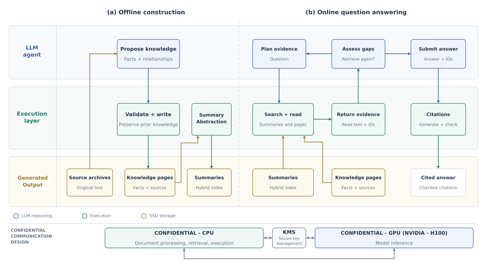

# MESH

**Efficient and accurate multi-hop retrieval over confidential enterprise knowledge.**

MESH compiles a document collection into a source-preserving, linked knowledge Wiki, then answers multi-hop questions with a single LLM agent that navigates the Wiki, tracks which evidence is still missing, and submits answers whose citations are checked against text it actually read. The method is designed to run inside a confidential CPU–GPU environment (Intel TDX + NVIDIA H100 confidential computing).

---

## Why MESH

Enterprise questions often need facts scattered across several documents ("Which team owns the policy that replaced X?"). Plain RAG tends to retrieve one relevant chunk and stop, and its answers are hard to audit. MESH addresses this with three ideas:

1. **Relationship-guided navigation.** Knowledge pages are grouped by their explicit links into overlapping neighborhoods, and each group gets a navigation summary searched with hybrid BM25 + dense retrieval.
2. **Evidence-state multi-hop acquisition.** The agent keeps an explicit list of evidence requirements, and unresolved ones drive the next search. Answers are accepted only when every requirement is backed by evidence the agent actually read.
3. **Bounded execution.** Pre-reads, embedding caches, a combined search-and-read operation, and hard budgets on tool calls, turns, tokens, and time keep latency predictable.

## Architecture



The overview is organized as three horizontal lanes that separate **who does the work**:

- **LLM agent (blue):** reasoning steps. The model proposes, plans, and decides; it never writes storage or certifies its own citations.
- **Execution layer (green):** deterministic code that validates, writes, searches, reads, and checks.
- **Generated Output (gold):** artifacts on SSD storage that both phases share.

**(a) Offline construction.** Source archives feed the LLM, which *proposes knowledge* (facts plus page relationships). The execution layer *validates and writes* those proposals into knowledge pages, preserving prior knowledge instead of overwriting it. Related pages are then abstracted into navigation summaries backed by a hybrid index.

**(b) Online question answering.** The agent *plans the evidence* a question needs. The execution layer *searches and reads* the shared summaries and knowledge pages, then *returns evidence*: the text actually read, tagged with evidence IDs. The agent *assesses gaps* and either retrieves again or *submits an answer* with those IDs. The execution layer then *generates and checks citations* before releasing a cited answer.

**Confidential communication design (bottom).** Document processing, retrieval, and execution run on a **confidential CPU** (Intel TDX); model inference runs on a **confidential GPU** (NVIDIA H100). Both obtain keys from a **KMS** after attestation and communicate over a protected CPU–GPU channel. This part is a proposed deployment design, not yet validated on hardware.

Documents are organized in three layers:

| Layer | Role | Used as answer evidence? |
| --- | --- | --- |
| Source archives | Preserve original document content by content hash | Yes |
| Knowledge pages | Collect facts per entity/policy, each citing its sources, linked via *Related Pages* | Yes |
| Navigation summaries | Describe groups of related pages to help locate them | No, navigation only |

## How it works

### 1. Source-preserving Wiki compilation

- Each document is archived under its **SHA256 content hash**; changed content creates a new entry.
- For each batch, a selection model picks up to 15 relevant existing pages. The generation model then proposes page metadata, facts, source references, and related-page links.
- The **execution layer validates** every proposal: paths, sources, relationship targets, and update records. Every fact must cite supplied evidence, and existing pages can only be updated if the model was shown them. Invalid proposals get feedback for up to two corrective retries, then the batch falls back to per-document retries.
- **Incremental preservation:** new facts never overwrite old ones. Each new fact records its relation to prior knowledge (*addition, elaboration, temporal update, correction,* or *conflict*) along with a reason and an optional validity time.

### 2. Relationship-guided hybrid navigation

Each page and its direct links form a group $G_p = \{p\} \cup R(p)$. Identical groups are deduplicated and strict subsets are removed, but **overlapping groups are kept**: $\{A,B,C\}$ and $\{A,B,D\}$ both survive while $\{A,B\}$ is dropped. This preserves different contexts around shared pages.

Summaries are retrieved with **BM25** ($k_1 = 1.5$, $b = 0.75$) and **dense max-chunk similarity**, fused by **reciprocal rank fusion** ($k_{\mathrm{RRF}} = 60$, 20 candidates per ranking). A summary is used only if its membership and content fingerprint match the loaded Wiki snapshot.

### 3. Evidence-state multi-hop QA

- The agent maintains requirements $(r_j, u_j, z_j, I_j)$: an ID, the needed information, its status, and the evidence IDs supporting it.
- Every actual read registers **evidence IDs** that map to an exact quotation, content version, and page offsets or source lines. Summaries and directory listings are never citable.
- A submission is accepted only if every requirement is supported and every cited ID matches delivered text. Otherwise the agent gets feedback and keeps searching. If the budget runs out, it answers **unknown**.
- **Latency profile defaults:** 2 pre-read pages, 15 tool operations, 17 model turns, 4,000-token limits for navigation and for page reads, and a 120 s per-question deadline. All of these are configurable.

### 4. Confidential CPU–GPU execution (proposed)

- The application, retrieval, evidence tracking, and citation validation run inside an **Intel TDX** confidential VM.
- LLM inference runs on an **NVIDIA H100** in confidential-computing mode, with encrypted bounce buffers and SPDM-secured CPU–GPU communication.
- An owner-controlled verifier checks CPU and GPU attestation before the KMS releases storage keys. Documents, pages, embeddings, caches, and logs live on an encrypted volume.

## Repository layout

```text
mesh_bench/              Core implementation
  bench_ingest.py          Wiki construction pipeline
  wiki_documents.py        Page parsing / rendering
  knowledge_updates.py     Incremental fact relations
  build_summaries.py       Page grouping + navigation summaries
  summary_retrieval.py     BM25 + dense + RRF retrieval
  embedding_client.py      Embedding service client and cache
  wiki_agent.py            Single-agent multi-hop QA loop
  wiki_retriever.py        Search / read tools for the agent
  evidence_snapshots.py    Evidence ID registry
  qa_contract.py           Submission, citation, and coverage checks
  run.py                   Offline build entry point
  run_qa.py                QA entry point
  evaluate.py              EM / F1 evaluation
configs/                 Page types and Wiki schema
docs/                    Design notes and experiment write-ups
examples/                Example run scripts and Azure config
tests/                   Unit tests
```

## Quick start

### Install

```bash
python3 -m venv .venv && source .venv/bin/activate
pip install -r requirements.txt
```

### Configure models

MESH works with any OpenAI-compatible endpoint:

```bash
export OPENAI_API_KEY=sk-...
export OPENAI_BASE_URL=https://api.openai.com/v1
export LLM_PREMIUM_MODEL=gpt-4o        # QA agent and generation
export LLM_FAST_MODEL=gpt-4o-mini      # selection and lighter tasks
export EMBEDDING_MODEL=text-embedding-3-large
```

For Azure AI Foundry / Azure OpenAI, see [examples/azure-models.env.example](examples/azure-models.env.example) and [docs/azure-models.md](docs/azure-models.md).

### Build the Wiki

```bash
# Download -> preprocess -> ingest -> summaries, then prepare the hybrid index
python -m mesh_bench.run --dataset hotpotqa --limit 500 --prepare-retrieval-index
```

Supported benchmarks: `hotpotqa`, `musique`, and `2wikimhqa`. Use `--all` to build all three.

### Ask questions and evaluate

```bash
python -m mesh_bench.run_qa --dataset hotpotqa --limit 500 --evaluate
```

Useful options:

| Flag | Purpose |
| --- | --- |
| `--summary-mode {hybrid,bm25,dense,tree}` | Retrieval method (`tree` is the navigation baseline) |
| `--qa-profile {latency,baseline}` | Latency-optimized loop or the original navigation loop |
| `--t-max N` | Total tool-call budget |
| `--prefetch-pages N` | Pages pre-read before the first model turn |
| `--question-time-budget SECONDS` | Per-question deadline (`0` disables it) |
| `--resume` | Rerun only missing or failed questions |

Outputs go to `wiki_output/<dataset>/wiki/` and `results/<dataset>/predictions.jsonl`. See [examples/run_hotpotqa.sh](examples/run_hotpotqa.sh) for an end-to-end script.

### Run tests

```bash
python -m unittest discover -s tests
```

## Limitations

- Validation checks **provenance and recorded coverage**. It does not prove the agent found every necessary hop or reasoned correctly.
- Dense retrieval is an exact local scan, $O(Cd)$ over $C$ chunks; no ANN index is used.
- Full conversation history is retained, so per-call limits do not bound total prompt size.
- The TDX/H100 deployment is a design; TEE overhead and security guarantees have not been measured on hardware.

## Citation

If you use MESH, please cite:

> *Efficient and Accurate Multi-Hop Retrieval of Confidential Enterprise Knowledge in Trusted Execution Environments.* (Capstone project, in preparation.)
